<!-- Generated by github.com/trick77/ship/kit/schemadoc, do not edit. Regenerate in the Go module directory: SCHEMADOC_UPDATE=1 go test ./... -run TestSchemaDoc -->

# Database schema

28 tables; the diagram is at the end. Go types are the `model.go` structs whose rows they hold.

## chunks

Go types:

- `ask.Source` (internal/ask): Source is one piece of code the answer may be built on, and the reason it is here. The reason is not decoration: it is what lets an answer say "this file came in because grant.go calls NewGrant" instead of presenting twenty files as equally relevant.
- `retrieve.Hit` (internal/retrieve): Hit is one retrieved chunk, carrying everything a citation needs: repo, branch, path and line range. They are joined in the retrieval query rather than looked up afterwards, because every claim rongo makes must be citable and a second lookup is a second chance to lose the branch.

| Column | Type | Null | Default | PK |
| --- | --- | --- | --- | --- |
| `id` | INTEGER | no |  | 1 |
| `file_id` | INTEGER | no |  |  |
| `ordinal` | INTEGER | no |  |  |
| `start_line` | INTEGER | no |  |  |
| `end_line` | INTEGER | no |  |  |
| `symbol` | TEXT | no | `''` |  |
| `raw_text` | TEXT | no |  |  |
| `content_hash` | TEXT | no |  |  |

Foreign keys:

- `file_id` → `files` (`id`), on delete CASCADE

Indexes:

- `idx_chunks_hash` (`content_hash`)
- `sqlite_autoindex_chunks_1` (`file_id`, `ordinal`) unique

## chunks_fts

Virtual table: `fts5(raw_text)`.

| Column | Type | Null | Default | PK |
| --- | --- | --- | --- | --- |
| `raw_text` |  | yes |  |  |

## chunks_vec

Virtual table: `vec0(embedding float[1536])`.

| Column | Type | Null | Default | PK |
| --- | --- | --- | --- | --- |
| `embedding` |  | yes |  |  |

## citations

Go types:

- `ask.Citation` (internal/ask): Citation is one entry of the evidence panel. The branch travels with it because a forge URL without one may 404 off the default branch. The SHA is the commit the cited file was indexed at: the source viewer reads the file at that commit, so the cited lines are the lines the answer was written from even after the branch has moved on.

| Column | Type | Null | Default | PK |
| --- | --- | --- | --- | --- |
| `id` | INTEGER | no |  | 1 |
| `message_id` | INTEGER | no |  |  |
| `marker` | INTEGER | no |  |  |
| `repo` | TEXT | no |  |  |
| `branch` | TEXT | no |  |  |
| `path` | TEXT | no |  |  |
| `start_line` | INTEGER | no | `0` |  |
| `end_line` | INTEGER | no | `0` |  |
| `sha` | TEXT | no | `''` |  |
| `kind` | TEXT | no | `''` |  |
| `subject` | TEXT | no | `''` |  |
| `committed_at` | TEXT | no | `''` |  |

Foreign keys:

- `message_id` → `messages` (`id`), on delete CASCADE

Indexes:

- `sqlite_autoindex_citations_1` (`message_id`, `marker`) unique

## clarification_candidates

Go types:

- `threads.Candidate` (internal/threads): Candidate is one entry on a clarification card, without its hits.

| Column | Type | Null | Default | PK |
| --- | --- | --- | --- | --- |
| `clarification_id` | INTEGER | no |  |  |
| `idx` | INTEGER | no |  |  |
| `repo` | TEXT | no |  |  |
| `branch` | TEXT | no |  |  |
| `module_key` | TEXT | no |  |  |
| `title` | TEXT | no |  |  |
| `summary` | TEXT | no |  |  |
| `hits` | TEXT | no |  |  |
| `members` | TEXT | no | `''` |  |

Foreign keys:

- `clarification_id` → `clarifications` (`id`), on delete CASCADE

Indexes:

- `sqlite_autoindex_clarification_candidates_1` (`clarification_id`, `idx`) unique

## clarifications

Go types:

- `threads.Clarification` (internal/threads): Clarification is the card a turn ended with: what rongo understood, and the candidates it offered. The hits each candidate was built from are NOT included here — they are large and never sent to the browser; fetch them with CandidateHits for the resumed turn only.

| Column | Type | Null | Default | PK |
| --- | --- | --- | --- | --- |
| `id` | INTEGER | no |  | 1 |
| `message_id` | INTEGER | no |  |  |
| `understanding` | TEXT | no |  |  |
| `created_at` | TEXT | no | `datetime('now')` |  |
| `too_broad` | INTEGER | no | `0` |  |

Foreign keys:

- `message_id` → `messages` (`id`), on delete CASCADE

Indexes:

- `sqlite_autoindex_clarifications_1` (`message_id`) unique

## commits

Go types:

- `history.Commit` (internal/history): Commit is one search result. Author is deliberately not here.

| Column | Type | Null | Default | PK |
| --- | --- | --- | --- | --- |
| `id` | INTEGER | no |  | 1 |
| `repo` | TEXT | no |  |  |
| `sha` | TEXT | no |  |  |
| `committed_at` | TEXT | no |  |  |
| `author` | TEXT | no | `''` |  |
| `subject` | TEXT | no |  |  |
| `body` | TEXT | no | `''` |  |
| `paths` | TEXT | no | `''` |  |

Foreign keys:

- `repo` → `repo_state` (`name`), on delete CASCADE

Indexes:

- `idx_commits_repo_date` (`repo`, `committed_at DESC`)
- `sqlite_autoindex_commits_1` (`repo`, `sha`) unique

## commits_fts

Virtual table: `fts5(subject, body, paths)`.

| Column | Type | Null | Default | PK |
| --- | --- | --- | --- | --- |
| `subject` |  | yes |  |  |
| `body` |  | yes |  |  |
| `paths` |  | yes |  |  |

## embed_cache

| Column | Type | Null | Default | PK |
| --- | --- | --- | --- | --- |
| `content_hash` | TEXT | no |  | 1 |
| `model` | TEXT | no |  | 2 |
| `dim` | INTEGER | no |  |  |
| `embedding` | BLOB | no |  |  |
| `created_at` | TEXT | no | `datetime('now')` |  |

## files

Go types:

- `ask.ModelRef` (internal/ask): ModelRef is one process model file the index carries.

| Column | Type | Null | Default | PK |
| --- | --- | --- | --- | --- |
| `id` | INTEGER | no |  | 1 |
| `repo` | TEXT | no |  |  |
| `path` | TEXT | no |  |  |
| `sha` | TEXT | no |  |  |
| `lang` | TEXT | no | `''` |  |
| `size` | INTEGER | no | `0` |  |
| `skip_reason` | TEXT | no | `''` |  |

Foreign keys:

- `repo` → `repo_state` (`name`), on delete CASCADE

Indexes:

- `sqlite_autoindex_files_1` (`repo`, `path`) unique

## integration_tokens

Go types:

- `edges.Neighbour` (internal/edges): Neighbour is a file on the far side of an integration edge: it names the same queue or route as the file asked about, and lives in a DIFFERENT repository.

| Column | Type | Null | Default | PK |
| --- | --- | --- | --- | --- |
| `id` | INTEGER | no |  | 1 |
| `file_id` | INTEGER | no |  |  |
| `kind` | TEXT | no |  |  |
| `value` | TEXT | no |  |  |
| `line` | INTEGER | no | `0` |  |

Foreign keys:

- `file_id` → `files` (`id`), on delete CASCADE

Indexes:

- `idx_integration_tokens_file` (`file_id`)
- `idx_integration_tokens_value` (`kind`, `value`)

## memories

Go types:

- `memory.Row` (internal/memory): Row is one standing instruction as the page and the prompt see it.

| Column | Type | Null | Default | PK |
| --- | --- | --- | --- | --- |
| `id` | INTEGER | no |  | 1 |
| `user_subject` | TEXT | no |  |  |
| `text` | TEXT | no |  |  |
| `kind` | TEXT | no | `'stated'` |  |
| `scope` | TEXT | no | `''` |  |
| `source_message_id` | INTEGER | yes |  |  |
| `created_at` | TEXT | no | `datetime('now')` |  |

Foreign keys:

- `source_message_id` → `messages` (`id`), on delete SET NULL
- `user_subject` → `users` (`subject`), on delete CASCADE

Indexes:

- `idx_memories_user` (`user_subject`, `created_at`)

Checks:

- `CHECK (kind IN ('stated', 'inferred'))`

## message_fts

Virtual table: `fts5(thread_id UNINDEXED, question, answer, tokenize = 'unicode61 remove_diacritics 2')`.

| Column | Type | Null | Default | PK |
| --- | --- | --- | --- | --- |
| `thread_id` |  | yes |  |  |
| `question` |  | yes |  |  |
| `answer` |  | yes |  |  |

## message_sources

Go types:

- `threads.recorded` (internal/threads): recorded is one message_sources row as stored.

| Column | Type | Null | Default | PK |
| --- | --- | --- | --- | --- |
| `message_id` | INTEGER | no |  |  |
| `chunk_id` | INTEGER | no | `0` |  |
| `commit_id` | INTEGER | no | `0` |  |
| `reason` | TEXT | no |  |  |
| `hop` | INTEGER | no | `0` |  |
| `repo` | TEXT | no | `''` |  |
| `path` | TEXT | no | `''` |  |
| `sha` | TEXT | no | `''` |  |
| `start_line` | INTEGER | no | `0` |  |
| `end_line` | INTEGER | no | `0` |  |
| `symbol` | TEXT | no | `''` |  |

Foreign keys:

- `message_id` → `messages` (`id`), on delete CASCADE

Indexes:

- `sqlite_autoindex_message_sources_1` (`message_id`, `chunk_id`, `commit_id`) unique

## message_usage

Go types:

- `usage.Call` (internal/usage): Call is one paid request, as the upstream reported it.

| Column | Type | Null | Default | PK |
| --- | --- | --- | --- | --- |
| `id` | INTEGER | no |  | 1 |
| `message_id` | INTEGER | no |  |  |
| `step` | TEXT | no |  |  |
| `model` | TEXT | no |  |  |
| `prompt_tokens` | INTEGER | no |  |  |
| `completion_tokens` | INTEGER | no |  |  |
| `cached_tokens` | INTEGER | yes |  |  |
| `reasoning_tokens` | INTEGER | yes |  |  |
| `ms` | INTEGER | yes |  |  |
| `cost_nano_usd` | INTEGER | yes |  |  |

Foreign keys:

- `message_id` → `messages` (`id`), on delete CASCADE

Indexes:

- `idx_message_usage_message` (`message_id`)

## messages

Go types:

- `threads.Message` (internal/threads): Message is one ANSWER ATTEMPT: a question and what came of it. It is not one question — a resume, a retry and a re-explain each append a row that repeats the question text of the row it continues, and HeadMessageID is what says they are all the same turn.

| Column | Type | Null | Default | PK |
| --- | --- | --- | --- | --- |
| `id` | INTEGER | no |  | 1 |
| `thread_id` | INTEGER | no |  |  |
| `ordinal` | INTEGER | no |  |  |
| `audience` | TEXT | no |  |  |
| `question` | TEXT | no |  |  |
| `answer` | TEXT | no | `''` |  |
| `error` | TEXT | no | `''` |  |
| `from_clarification_id` | INTEGER | yes |  |  |
| `from_candidate_idx` | INTEGER | no | `-1` |  |
| `created_at` | TEXT | no | `datetime('now')` |  |
| `language` | TEXT | no | `'en'` |  |
| `scope` | TEXT | no | `''` |  |
| `followups` | TEXT | no | `''` |  |
| `head_message_id` | INTEGER | no | `0` |  |
| `steps` | TEXT | no | `''` |  |
| `pasted_texts` | TEXT | no | `'[]'` |  |
| `memory_id` | INTEGER | yes |  |  |

Foreign keys:

- `memory_id` → `memories` (`id`), on delete SET NULL
- `from_clarification_id` → `clarifications` (`id`), on delete SET NULL
- `thread_id` → `threads` (`id`), on delete CASCADE

Indexes:

- `idx_messages_from_clarification` (`from_clarification_id`) where `from_clarification_id IS NOT NULL`
- `sqlite_autoindex_messages_1` (`thread_id`, `ordinal`) unique

Checks:

- `CHECK (audience IN ('ba', 'dev'))`

## repo_deps

| Column | Type | Null | Default | PK |
| --- | --- | --- | --- | --- |
| `id` | INTEGER | no |  | 1 |
| `repo` | TEXT | no |  |  |
| `coordinate` | TEXT | no |  |  |
| `direction` | TEXT | no |  |  |

Foreign keys:

- `repo` → `repo_state` (`name`), on delete CASCADE

Indexes:

- `idx_repo_deps_coordinate` (`coordinate`)
- `sqlite_autoindex_repo_deps_1` (`repo`, `coordinate`, `direction`) unique

Checks:

- `CHECK (direction IN ('publishes', 'requires'))`

## repo_stages

Go types:

- `stages.Stage` (internal/stages): Stage is one declared stage of one repository.

| Column | Type | Null | Default | PK |
| --- | --- | --- | --- | --- |
| `repo` | TEXT | no |  | 1 |
| `name` | TEXT | no |  | 2 |
| `prefix` | TEXT | no |  |  |
| `aliases` | TEXT | no | `''` |  |

Foreign keys:

- `repo` → `repo_state` (`name`), on delete CASCADE

## repo_state

Go types:

- `ask.RepoHead` (internal/ask): RepoHead is what the release turn needs to know about a repository's checkout: the commit the index was built from, the commit the remote branch is at, and whether the entry is a snapshot, which has no tags.
- `indexer.RepoState` (internal/indexer): RepoState is a repository's recorded indexing state.

| Column | Type | Null | Default | PK |
| --- | --- | --- | --- | --- |
| `name` | TEXT | yes |  | 1 |
| `clone_url` | TEXT | no |  |  |
| `branch` | TEXT | no | `''` |  |
| `enabled` | INTEGER | no | `1` |  |
| `token_env` | TEXT | no | `''` |  |
| `last_sha` | TEXT | no | `''` |  |
| `last_run_at` | TEXT | no | `''` |  |
| `last_error` | TEXT | no | `''` |  |
| `file_count` | INTEGER | no | `0` |  |
| `chunk_count` | INTEGER | no | `0` |  |
| `project` | TEXT | no | `''` |  |
| `part` | TEXT | no | `''` |  |
| `description` | TEXT | no | `''` |  |
| `last_indexed_at` | TEXT | no | `''` |  |
| `token_user` | TEXT | no | `''` |  |
| `token_auth` | TEXT | no | `''` |  |
| `library` | INTEGER | no | `0` |  |
| `image` | TEXT | no | `''` |  |
| `reindex_requested` | INTEGER | no | `0` |  |

## repo_uses

| Column | Type | Null | Default | PK |
| --- | --- | --- | --- | --- |
| `id` | INTEGER | no |  | 1 |
| `repo` | TEXT | no |  |  |
| `uses` | TEXT | no |  |  |

Foreign keys:

- `repo` → `repo_state` (`name`), on delete CASCADE

Indexes:

- `sqlite_autoindex_repo_uses_1` (`repo`, `uses`) unique

## shared_threads

Go types:

- `threads.Share` (internal/threads): Share is one thread readable by anyone holding the link.

| Column | Type | Null | Default | PK |
| --- | --- | --- | --- | --- |
| `id` | INTEGER | no |  | 1 |
| `token` | TEXT | no |  |  |
| `thread_id` | INTEGER | no |  |  |
| `user_subject` | TEXT | no |  |  |
| `revoked` | INTEGER | no | `0` |  |
| `up_to_message_id` | INTEGER | no |  |  |
| `shared_at` | TEXT | no | `datetime('now')` |  |
| `updated_at` | TEXT | no | `datetime('now')` |  |

Foreign keys:

- `user_subject` → `users` (`subject`), on delete CASCADE
- `thread_id` → `threads` (`id`), on delete CASCADE

Indexes:

- `idx_shared_threads_user` (`user_subject`, `shared_at`)
- `sqlite_autoindex_shared_threads_1` (`token`) unique
- `sqlite_autoindex_shared_threads_2` (`thread_id`) unique

Checks:

- `CHECK (revoked IN (0, 1))`

## symbols

| Column | Type | Null | Default | PK |
| --- | --- | --- | --- | --- |
| `id` | INTEGER | no |  | 1 |
| `file_id` | INTEGER | no |  |  |
| `name` | TEXT | no |  |  |
| `kind` | TEXT | no | `''` |  |
| `line` | INTEGER | no | `0` |  |
| `scope` | TEXT | no | `''` |  |

Foreign keys:

- `file_id` → `files` (`id`), on delete CASCADE

Indexes:

- `idx_symbols_file` (`file_id`)
- `idx_symbols_name` (`name`)

## thread_feedback

| Column | Type | Null | Default | PK |
| --- | --- | --- | --- | --- |
| `thread_id` | INTEGER | no |  | 1 |
| `verdict` | INTEGER | no |  |  |
| `reason` | TEXT | no | `''` |  |
| `up_to_message_id` | INTEGER | no |  |  |
| `updated_at` | TEXT | no | `datetime('now')` |  |

Foreign keys:

- `up_to_message_id` → `messages` (`id`), on delete CASCADE
- `thread_id` → `threads` (`id`), on delete CASCADE

Checks:

- `CHECK (verdict IN (-1, 1))`
- `CHECK (reason IN ('', 'wrong', 'incomplete', 'missed_code', 'too_long', 'wrong_repo'))`

## thread_fts

Virtual table: `fts5(title, tokenize = 'unicode61 remove_diacritics 2')`.

| Column | Type | Null | Default | PK |
| --- | --- | --- | --- | --- |
| `title` |  | yes |  |  |

## threads

Go types:

- `threads.Thread` (internal/threads): Thread is one conversation.

| Column | Type | Null | Default | PK |
| --- | --- | --- | --- | --- |
| `id` | INTEGER | no |  | 1 |
| `user_subject` | TEXT | no |  |  |
| `title` | TEXT | no | `''` |  |
| `created_at` | TEXT | no | `datetime('now')` |  |
| `title_settled` | INTEGER | no | `0` |  |
| `public_id` | TEXT | no | `''` |  |
| `starred` | INTEGER | no | `0` |  |

Foreign keys:

- `user_subject` → `users` (`subject`), on delete CASCADE

Indexes:

- `idx_threads_public_id` (`public_id`) unique where `public_id != ''`
- `idx_threads_user` (`user_subject`, `created_at`)
- `idx_threads_user_starred` (`user_subject`, `starred`, `id DESC`)

Checks:

- `CHECK (starred IN (0, 1))`

## unit_deps

Go types:

- `units.Dep` (internal/units): Dep is one edge: From uses To (a sibling unit's Key), or, with To empty, uses Coordinate — something outside the repository.

| Column | Type | Null | Default | PK |
| --- | --- | --- | --- | --- |
| `repo` | TEXT | no |  | 1 |
| `from_key` | TEXT | no |  | 2 |
| `to_key` | TEXT | no | `''` | 3 |
| `coordinate` | TEXT | no | `''` | 4 |

## units

Go types:

- `units.Unit` (internal/units): Unit is one declared piece of a repository.

| Column | Type | Null | Default | PK |
| --- | --- | --- | --- | --- |
| `repo` | TEXT | no |  | 1 |
| `key` | TEXT | no |  | 2 |
| `kind` | TEXT | no |  |  |
| `name` | TEXT | no |  |  |
| `tags` | TEXT | no | `''` |  |

## users

Go types:

- `auth.User` (internal/auth): User is an authenticated identity.

| Column | Type | Null | Default | PK |
| --- | --- | --- | --- | --- |
| `id` | INTEGER | no |  | 1 |
| `subject` | TEXT | no |  |  |
| `email` | TEXT | no | `''` |  |
| `is_admin` | INTEGER | no | `0` |  |
| `created_at` | TEXT | no | `datetime('now')` |  |

Indexes:

- `sqlite_autoindex_users_1` (`subject`) unique

## Types not stored as rows

### indexer.Counts

In `internal/indexer`. Counts is what one indexing run produced.

| Field | Type | Doc |
| --- | --- | --- |
| `Files` | `int` |  |
| `Chunks` | `int` |  |

### indexer.VecCompaction

In `internal/indexer`. VecCompaction is what one CompactVectors call found and did. Chunks are vec0's storage chunks (chunks_vec_chunks rows), not rongo's chunks.

| Field | Type | Doc |
| --- | --- | --- |
| `Compacted` | `bool` |  |
| `Rows` | `int64` |  |
| `ChunksBefore` | `int64` |  |
| `ChunksAfter` | `int64` |  |

## Diagram

```mermaid
erDiagram
    chunks {
        INTEGER id PK
        INTEGER file_id FK
        INTEGER ordinal
        INTEGER start_line
        INTEGER end_line
        TEXT symbol
        TEXT raw_text
        TEXT content_hash
    }
    chunks_fts {
        ANY raw_text
    }
    chunks_vec {
        ANY embedding
    }
    citations {
        INTEGER id PK
        INTEGER message_id FK
        INTEGER marker
        TEXT repo
        TEXT branch
        TEXT path
        INTEGER start_line
        INTEGER end_line
        TEXT sha
        TEXT kind
        TEXT subject
        TEXT committed_at
    }
    clarification_candidates {
        INTEGER clarification_id FK
        INTEGER idx
        TEXT repo
        TEXT branch
        TEXT module_key
        TEXT title
        TEXT summary
        TEXT hits
        TEXT members
    }
    clarifications {
        INTEGER id PK
        INTEGER message_id FK
        TEXT understanding
        TEXT created_at
        INTEGER too_broad
    }
    commits {
        INTEGER id PK
        TEXT repo FK
        TEXT sha
        TEXT committed_at
        TEXT author
        TEXT subject
        TEXT body
        TEXT paths
    }
    commits_fts {
        ANY subject
        ANY body
        ANY paths
    }
    embed_cache {
        TEXT content_hash PK
        TEXT model PK
        INTEGER dim
        BLOB embedding
        TEXT created_at
    }
    files {
        INTEGER id PK
        TEXT repo FK
        TEXT path
        TEXT sha
        TEXT lang
        INTEGER size
        TEXT skip_reason
    }
    integration_tokens {
        INTEGER id PK
        INTEGER file_id FK
        TEXT kind
        TEXT value
        INTEGER line
    }
    memories {
        INTEGER id PK
        TEXT user_subject FK
        TEXT text
        TEXT kind
        TEXT scope
        INTEGER source_message_id FK
        TEXT created_at
    }
    message_fts {
        ANY thread_id
        ANY question
        ANY answer
    }
    message_sources {
        INTEGER message_id FK
        INTEGER chunk_id
        INTEGER commit_id
        TEXT reason
        INTEGER hop
        TEXT repo
        TEXT path
        TEXT sha
        INTEGER start_line
        INTEGER end_line
        TEXT symbol
    }
    message_usage {
        INTEGER id PK
        INTEGER message_id FK
        TEXT step
        TEXT model
        INTEGER prompt_tokens
        INTEGER completion_tokens
        INTEGER cached_tokens
        INTEGER reasoning_tokens
        INTEGER ms
        INTEGER cost_nano_usd
    }
    messages {
        INTEGER id PK
        INTEGER thread_id FK
        INTEGER ordinal
        TEXT audience
        TEXT question
        TEXT answer
        TEXT error
        INTEGER from_clarification_id FK
        INTEGER from_candidate_idx
        TEXT created_at
        TEXT language
        TEXT scope
        TEXT followups
        INTEGER head_message_id
        TEXT steps
        TEXT pasted_texts
        INTEGER memory_id FK
    }
    repo_deps {
        INTEGER id PK
        TEXT repo FK
        TEXT coordinate
        TEXT direction
    }
    repo_stages {
        TEXT repo PK, FK
        TEXT name PK
        TEXT prefix
        TEXT aliases
    }
    repo_state {
        TEXT name PK
        TEXT clone_url
        TEXT branch
        INTEGER enabled
        TEXT token_env
        TEXT last_sha
        TEXT last_run_at
        TEXT last_error
        INTEGER file_count
        INTEGER chunk_count
        TEXT project
        TEXT part
        TEXT description
        TEXT last_indexed_at
        TEXT token_user
        TEXT token_auth
        INTEGER library
        TEXT image
        INTEGER reindex_requested
    }
    repo_uses {
        INTEGER id PK
        TEXT repo FK
        TEXT uses
    }
    shared_threads {
        INTEGER id PK
        TEXT token
        INTEGER thread_id FK
        TEXT user_subject FK
        INTEGER revoked
        INTEGER up_to_message_id
        TEXT shared_at
        TEXT updated_at
    }
    symbols {
        INTEGER id PK
        INTEGER file_id FK
        TEXT name
        TEXT kind
        INTEGER line
        TEXT scope
    }
    thread_feedback {
        INTEGER thread_id PK, FK
        INTEGER verdict
        TEXT reason
        INTEGER up_to_message_id FK
        TEXT updated_at
    }
    thread_fts {
        ANY title
    }
    threads {
        INTEGER id PK
        TEXT user_subject FK
        TEXT title
        TEXT created_at
        INTEGER title_settled
        TEXT public_id
        INTEGER starred
    }
    unit_deps {
        TEXT repo PK
        TEXT from_key PK
        TEXT to_key PK
        TEXT coordinate PK
    }
    units {
        TEXT repo PK
        TEXT key PK
        TEXT kind
        TEXT name
        TEXT tags
    }
    users {
        INTEGER id PK
        TEXT subject
        TEXT email
        INTEGER is_admin
        TEXT created_at
    }
    chunks }o--|| files : "file_id"
    citations }o--|| messages : "message_id"
    clarification_candidates }o--|| clarifications : "clarification_id"
    clarifications }o--|| messages : "message_id"
    commits }o--|| repo_state : "repo"
    files }o--|| repo_state : "repo"
    integration_tokens }o--|| files : "file_id"
    memories }o--o| messages : "source_message_id"
    memories }o--|| users : "user_subject"
    message_sources }o--|| messages : "message_id"
    message_usage }o--|| messages : "message_id"
    messages }o--o| memories : "memory_id"
    messages }o--o| clarifications : "from_clarification_id"
    messages }o--|| threads : "thread_id"
    repo_deps }o--|| repo_state : "repo"
    repo_stages }o--|| repo_state : "repo"
    repo_uses }o--|| repo_state : "repo"
    shared_threads }o--|| users : "user_subject"
    shared_threads }o--|| threads : "thread_id"
    symbols }o--|| files : "file_id"
    thread_feedback }o--|| messages : "up_to_message_id"
    thread_feedback }o--|| threads : "thread_id"
    threads }o--|| users : "user_subject"
```

